# Varelyx · submitted web architecture

The primary prototype is a static web app on Firebase Hosting. The earlier Python/FastAPI/OR-Tools implementation is an optional reference, not the submitted runtime. ADK, BigQuery, Firestore and Cloud Run are not used by the current web flow.

```mermaid
flowchart LR
  A[Supplier message] --> B[Gemini via Firebase AI Logic]
  B --> C[Typed fields and source-quote checks]
  C --> D[Human evidence and capacity review]
  D --> E[Deterministic scenario planner]
  E --> F[Independent client Proof Gate]
  F --> G[Explicit human approval]
  G --> H[Firebase Realtime Database]
  H --> I[Server read-back and reload]
```

| Boundary | Current implementation |
|---|---|
| Hosting | Firebase Hosting serves `public/`; no application server is required. |
| AI | Firebase AI Logic calls the configured Gemini model (`MODEL` in `public/core.mjs`) with JSON schema and an untrusted-message prompt. |
| Grounding | Required source quotations, numeric bounds, field/unit checks and conservative ambiguity/negation checks. These are not general semantic verification. |
| Missing fact | Deterministic one-variable sensitivity over disclosed fixed cases ranks capacity/route unknowns. Gemini does not select the highest-value question. |
| Planning | Enumerative, deterministic quantities across four fixed demand scenarios, using the current pack, MOQ, supplier, donor, route, emergency and cash policy. |
| Proof | A separate function recomputes eight listed checks. It can HOLD/BLOCK; it is client-side and does not verify every predicted outcome metric. |
| Approval | In-app review and explicit human confirmation; sandbox records only. No ERP/supplier integration. |
| Access | Anonymous Firebase Auth separates browser sessions; reCAPTCHA Enterprise App Check protects service calls under the deployed configuration. |
| Storage | Realtime Database REST transport, conditional ETag writes, server read-back and exact session restore. No localStorage save fallback. |
| Receipt | SHA-256 over evidence, plan, policy and checks. It does not supply a server-authoritative procurement decision. |
| UI | Compact Evidence/Plan/Verify/Approve views, Saved/Audit, English/Bangla/Khmer samples and display currency USD/BDT/KHR. |

## Trust and scaling path

Client-side proof is suitable for this transparent sandbox demonstration, not sufficient authorization for external procurement. A real deployment would require trusted server-side revalidation, enterprise identity/roles and approval policy before integrating ordering systems. Store/SKU feeds, empirical demand/lead-time evaluation, operational monitoring and capacity/quota planning would then follow. These are future work, not implemented capabilities or measured scale results.

No production App Check settings or database rules are relaxed for local development or tests. The private registered development token is excluded from Hosting and Git.
