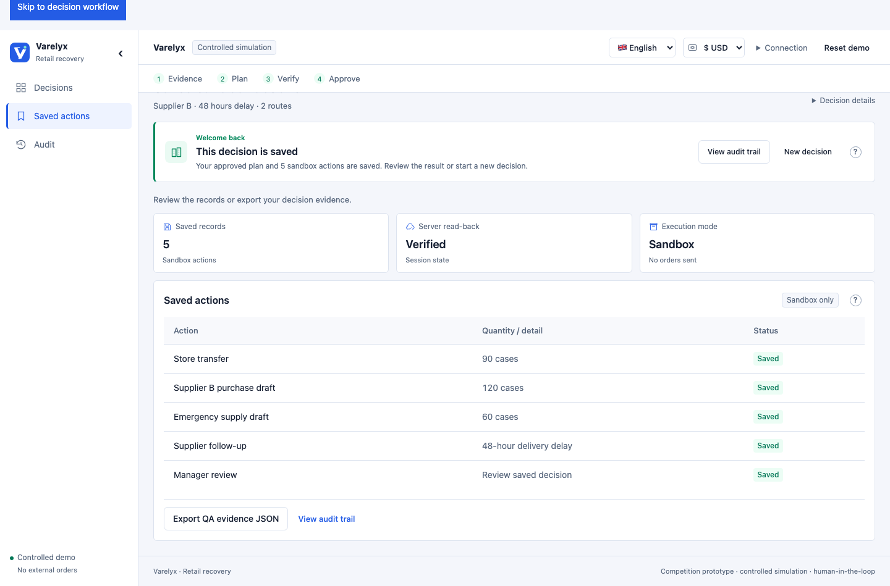
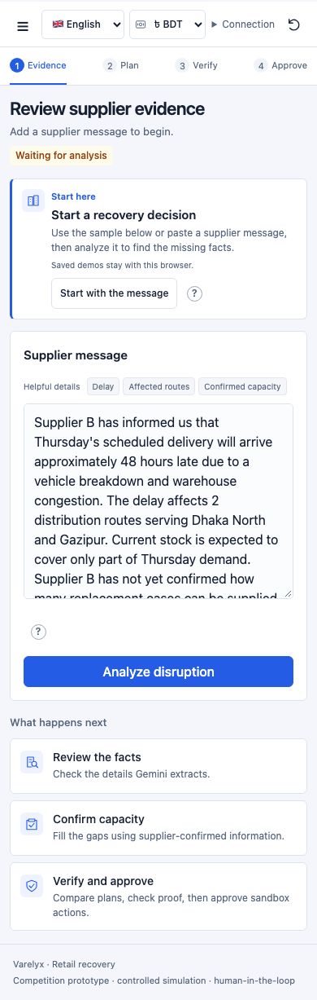
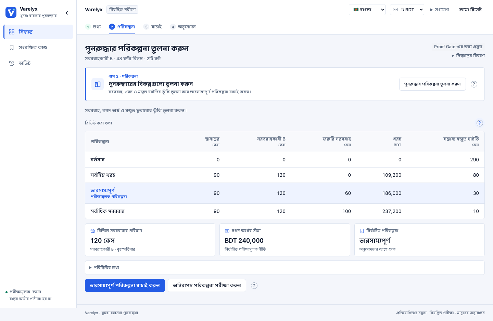
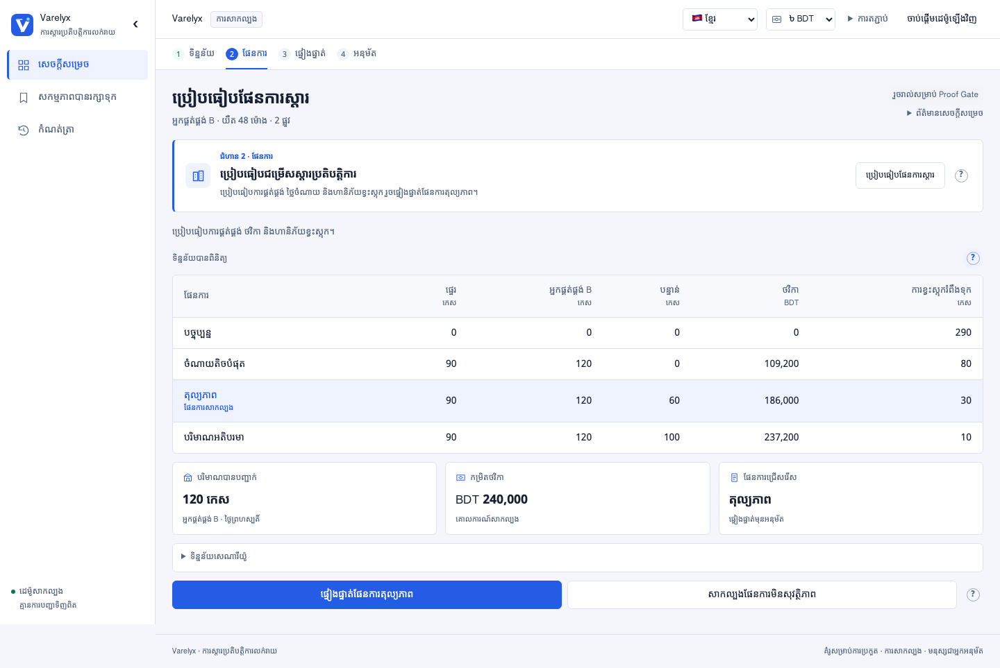

# PR #7 — compact multilingual workspace review

Review candidate for `fix/submission-reliability`, October 17, 2026. The work is ready for owner review; production release remains a separate gate.

## What to review

1. Start with a supplier message. New users see “Start here”; section help explains the flow without long text on every screen.
2. Confirm supplier facts and capacity. Unknown is distinct from zero; the explicit review dialog shows the source before saving.
3. Compare four compact recovery plans, run balanced PASS → unsafe BLOCK → balanced PASS, then explicitly approve.
4. Inspect five sandbox actions, receipt and audit history. Reload and reopen the root link; completed work opens Saved. “New decision” is confirmed and retains approved receipts.
5. Try English, Bangla and Khmer, plus USD/BDT/KHR display. Native source quotes remain verbatim and proof/save amounts remain BDT.

## Submission-first hardening

The candidate now also includes an accurate judge walkthrough/architecture and submission copy, refreshed official rules/deadlines, a reproducible 40-scenario constraint evaluation in CI, and strict release matching of the root document plus all public assets. The check detected that public Hosting still differs in 14/18 assets. Local checks passed: syntax, 134 Node, 13 Python, 72 browser cases (8 existing opt-in skips) and a fresh real-service flow. Owner release and final video/deck/portal acceptance remain pending. See `SUBMISSION_READINESS_2026-10-17.md`.

## Mobile help repair

The first remote browser run exposed a real interaction race: a queued smooth-scroll event dismissed help immediately after tap/focus opened it. Help now repositions within the viewport on scroll/resize. Mobile coverage uses touch emulation and an actual tap, followed by scroll, resize and containment assertions. Escape, outside-click, keyboard and workflow help checks remain intact. Fresh local results: syntax, 128 Node, 13 Python, all 72 browser cases (8 existing gated skips), plus a real Gemini/Firebase approval/save/reload/root-resume run passed. See `MOBILE_HELP_QA_2026-10-17.md`; current remote status is in the PR checks.

## Verification on the final candidate

- JavaScript syntax and **128 Node tests passed**.
- **13 Python reference tests passed** using Python 3.12.
- **72 responsive browser cases passed**, 8 opt-in live/capture cases skipped, with the registered local development server.
- A separate complete **72-case run passed** against the private-token-free static Node server now used by CI, again with 8 gated cases skipped.
- Real Gemini/Firebase flows passed in all three input languages. The latest application run additionally verified onboarding/root resume with English: five sandbox actions, revision 7, exact state equality across save/reload/root reopen, in 14.1 seconds. See `JOURNEY_UX_QA_2026-10-17.md`, `LOCALIZATION_QA_2026-10-17.md` and the raw exports under `evidence/2026-10-17/`.

PR preparation exposed dropped local module downloads (`ERR_CONNECTION_RESET`) under parallel Python static-server tests. A single-browser diagnostic loaded successfully; concurrent diagnostics reproduced resets on several local module files. CI now runs the existing loopback Node server in `STATIC_ONLY=1` mode. That mode neither creates nor serves an App Check device token. Dedicated tests verify the production entry is unmodified, the private endpoint returns 404, and module MIME/cache headers are correct. Smoke tests wait for initialized UI and report initialization/asset errors. The full static-server browser run passed after the server change.

## Screens

Saved decision after a real Gemini/Firebase run and exact reload restoration:

New-user mobile layout with isolated service fixtures (layout evidence):

Bangla and Khmer plan/help layouts with isolated fixtures. Any verification labels in these two images describe fixture state, not independent cloud tests:

## Scope

Shared cross-device decisions were postponed. Existing anonymous-user sessions stay private; no database access rules or production App Check settings changed. Reference exchange rates are dated/editable display inputs, not live conversion feeds. Proof Gate validates its listed constraints rather than every outcome metric or arbitrary source semantics. All persisted actions are synthetic sandbox records; no external orders are sent.

The earlier QA reports retain their original snapshot/commit wording. This candidate collects those verified changes for review. The canonical portfolio standard repository still returns HTTP 404 to this account; owner-side portfolio/Linear tracking remains pending.

Loaded-form correction: the actual round/template are accessible after loading; requirements are 3–4 minute video, PDF up to 5 MB, description up to 1024 characters. Initial empty-round text was transient. See `SUBMISSION_FORM_VALUES.md`.
